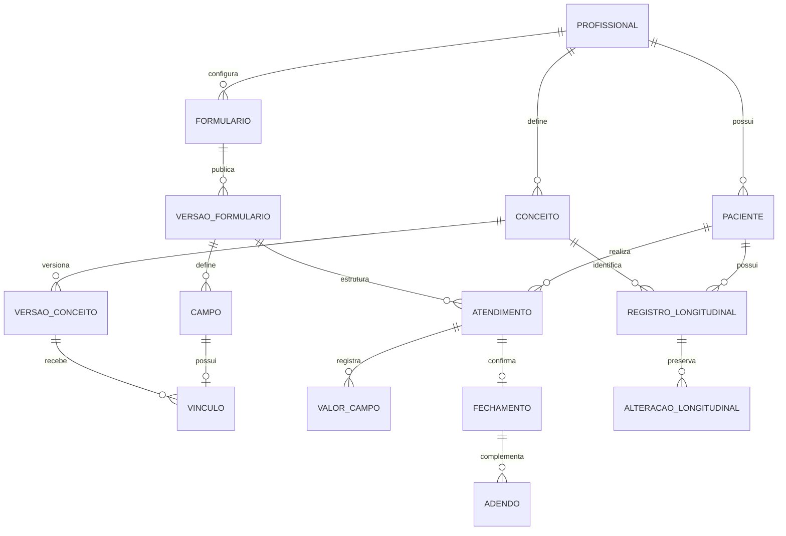
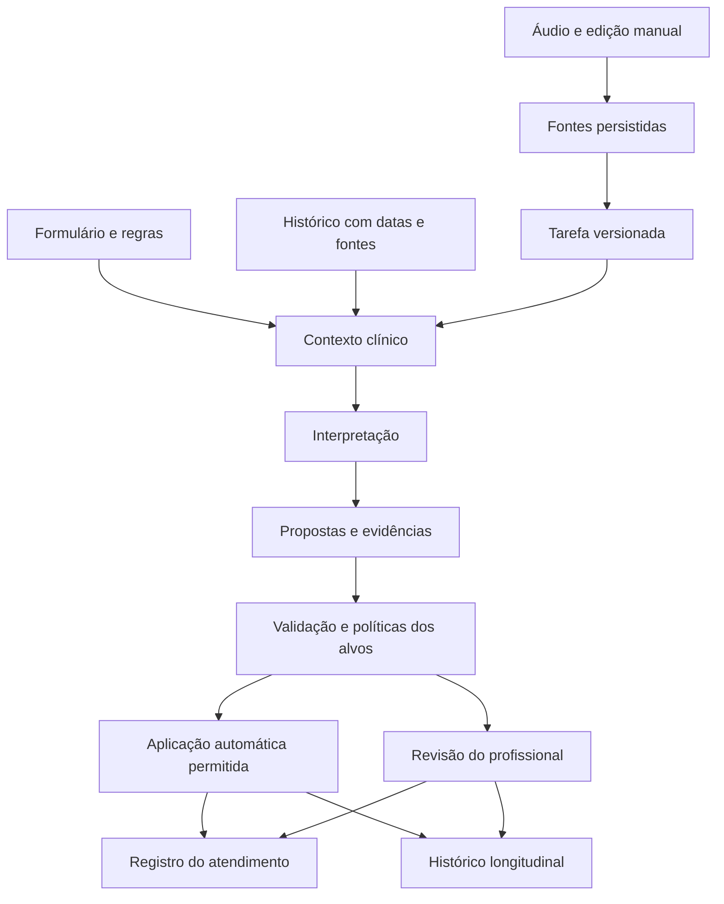

# Proposta de arquitetura — prontuário configurável assistido por IA

Data: 13/11/2026.

Status: proposta consolidada para avaliação. Não autoriza implementação.

## 1. Objetivo e limites

Construir um prontuário para várias especialidades no qual cada profissional configura seus formulários e a IA preenche os campos durante o atendimento. O profissional pode editar a qualquer momento, revisar sugestões e concluir o atendimento. Informações longitudinais acompanham o paciente entre formulários do mesmo profissional.

O trabalho acordado é construir um núcleo novo e reaproveitar seletivamente o projeto existente. Este documento descreve o destino arquitetural; não representa a estrutura ou as garantias já implementadas. Nenhuma reorganização, migração ou alteração de código faz parte desta entrega.

### Decisões confirmadas na discussão

- Dados exclusivos de cada profissional, sem compartilhamento clínico entre profissionais, inclusive quando atendem a mesma pessoa.
- Formulários com texto livre, grupos e listas estruturadas com subcampos.
- Configuração assistida por IA: o profissional descreve o campo e aprova melhorias de descrição, contextos e regras de interpretação.
- Cada campo pode ser do atendimento ou longitudinal. Inicialmente, um campo longitudinal aponta para um conceito, com grupos e subcampos dentro dele.
- Campos equivalentes compartilham conceitos mediante vínculo definido pelo profissional; a IA pode sugerir equivalências.
- Formatos diferentes podem representar o mesmo conceito. A interpretação de uma edição entre formatos exige confirmação antes de atualizar o histórico longitudinal, preservando o texto original.
- Preenchimento automático durante a consulta, proteção das correções manuais e aprovação de ambiguidades.
- Histórico anterior serve como contexto datado e não confirma validade atual por si só.
- Pendências podem ser descartadas explicitamente, preservando as decisões. O profissional pode finalizar sem concluir a IA, mediante revisão manual e confirmação dos trechos não processados.
- Após finalizar, alterações somente por adendos, com autor, data e motivo.
- Recuperação de texto e áudio ainda não enviados após fechar e reabrir a página, com retomada da sincronização.
- Serviço pode participar da recuperação das chaves locais, com verificação reforçada e auditoria.
- Equipe técnica pode ter acesso clínico temporário mediante autorização explícita do profissional e auditoria de todos os acessos.

### Não objetivos desta proposta

Não desenvolver um prontuário compartilhado de clínica, permitir decisões clínicas autônomas, garantir ausência de falhas ou manter gravação enquanto a página estiver fechada. Não selecionar agora fornecedores, versões de bibliotecas, modelos de IA, parâmetros criptográficos ou prazos legais de retenção.

O sucesso depende de preservar trabalho manual, explicar a origem dos dados, recuperar interrupções e manter consultas concluídas estáveis. Uma solução que aparenta salvar sem persistir, mistura profissionais ou reescreve registros silenciosamente falha nesses objetivos.

## 2. Abordagens consideradas

| Abordagem | Benefício | Custo e limite |
|---|---|---|
| Reorganizar o projeto atual | Aproveitamento imediato e evolução gradual | Mantém inicialmente dois motores e exige desfazer acoplamentos existentes |
| Núcleo novo com reaproveitamento seletivo | Modelo coerente com as decisões de produto | Exige avaliar componentes e planejar transição dos dados |
| Reescrita completa | Liberdade de desenho | Recria recursos aproveitáveis e amplia o esforço até um fluxo completo |

O usuário escolheu núcleo novo com reaproveitamento seletivo. A proposta é um monólito modular: uma aplicação web, uma API, banco compartilhado com propriedade por módulo e execução de tarefas persistentes. API e trabalhador podem executar em processos diferentes usando o mesmo código modular, sem criar microsserviços de negócio.

Manter TypeScript e avaliar reaproveitamento de Next.js, Fastify e Prisma é uma recomendação técnica, não uma decisão de produto confirmada. O banco de produção e o mecanismo de tarefas ainda devem ser escolhidos. Não se presume que o SQLite atual será suficiente para o destino operacional.

## 3. Estrutura proposta

```text
pep-ia/
├── apps/
│   ├── api/src/
│   │   ├── bootstrap/                 # API, trabalhador e composição
│   │   ├── modules/
│   │   │   ├── identidade/
│   │   │   ├── pacientes/
│   │   │   ├── agenda/
│   │   │   ├── formularios/
│   │   │   ├── conceitos-clinicos/
│   │   │   ├── atendimentos/
│   │   │   ├── historico-longitudinal/
│   │   │   ├── captura/
│   │   │   ├── assistencia-ia/
│   │   │   └── documentos/
│   │   └── platform/
│   │       ├── database/
│   │       ├── jobs/
│   │       ├── storage/
│   │       ├── security/
│   │       ├── audit/
│   │       ├── observability/
│   │       └── config/
│   └── web/src/
│       ├── app/                       # Rotas e composição
│       ├── features/
│       │   ├── pacientes/
│       │   ├── agenda/
│       │   ├── editor-formularios/
│       │   ├── atendimento/
│       │   ├── captura-audio/
│       │   ├── revisao-propostas/
│       │   ├── historico-paciente/
│       │   └── documentos/
│       ├── platform/
│       │   ├── local-vault/
│       │   ├── sync/
│       │   └── api/
│       └── shared/                    # UI e utilitários sem regra clínica
├── packages/
│   ├── api-contracts/
│   └── form-schema/
└── docs/
    ├── architecture/
    └── decisions/
```

Cada módulo de negócio possui, conforme sua complexidade:

```text
atendimentos/
├── domain/                  # Entidades, regras, políticas e eventos
├── application/
│   ├── use-cases/            # Operações completas
│   └── ports/               # Dependências necessárias às operações
├── infrastructure/          # Implementações de persistência e integrações
├── http/                    # Rotas, validação de entrada e handlers
└── public.ts                # Contratos públicos para outros módulos
```

Não criar camadas vazias nem interface para toda função. Domínio não importa Fastify, Prisma ou SDK de IA. Aplicação coordena regras e contratos; infraestrutura implementa acesso externo. Bootstrap conecta dependências. HTTP não chama outro controller.

Os pacotes compartilhados contêm contratos de transporte e a linguagem estrutural dos formulários. Não expõem entidades de persistência nem autorização do servidor. A validação compartilhada no navegador melhora a experiência, sem substituir validação na API.

## 4. Responsabilidades e comunicação

| Módulo | Propriedade e operações principais |
|---|---|
| Identidade | Profissionais, sessões, dispositivos, concessões técnicas e recuperação de acesso |
| Pacientes | Cadastro do paciente pertencente ao profissional |
| Agenda | Disponibilidade, agendamento e operações de calendário |
| Formulários | Rascunhos, configuração assistida, campos e publicação de versões |
| Conceitos clínicos | Significados, estruturas de referência e versões dos conceitos |
| Atendimentos | Valores da consulta, propostas destinadas a eles, decisões, revisão, fechamento e adendos |
| Histórico longitudinal | Estado conhecido por paciente/conceito, propostas destinadas a ele e alterações |
| Captura | Gravações recebidas, segmentos, transcrições e suas revisões, atribuição de falantes e lacunas |
| Assistência por IA | Montagem de contexto, execuções, interpretações e evidências |
| Documentos | Geração, versões confirmadas e exportações vinculadas ao registro de origem |

Revisão é uma capacidade comum com contratos consistentes, mas a autorização de cada alteração pertence ao módulo do alvo. Não criar um módulo genérico com permissão de escrever em todas as tabelas clínicas. Auditoria e criptografia são capacidades técnicas; regras de concessão pertencem à identidade.

### Comunicação síncrona

Chamada interna por contrato público quando a resposta é necessária para continuar. Atendimento consulta versão publicada; assistência por IA consulta fontes, definições e contexto; documentos consulta versão fechada ou rascunho identificado. Não usar HTTP interno entre módulos do mesmo processo.

Nenhum módulo importa repositório ou implementação interna de outro. O banco pode ser compartilhado, mas cada módulo controla suas escritas. Relatórios e projeções de leitura podem cruzar dados por contratos ou consultas explicitamente autorizadas, sem transformar isso em escrita cruzada.

### Comunicação assíncrona

Eventos persistidos disparam transcrição, interpretação, notificações e geração demorada. O evento é registrado na mesma transação da alteração de origem e publicado posteriormente (outbox). Tarefas possuem identificador, entradas versionadas, estado, tentativas, prazo de posse e resultado.

Entrega pode ocorrer mais de uma vez. Consumidores precisam ser idempotentes. Notificação ao navegador é um sinal de atualização; após reconectar, a API fornece o estado autoritativo e o progresso perdido.

Dependências de leitura da IA não devem criar ciclo de execução: ela consulta contexto e produz interpretação; uma operação de aplicação entrega propostas aos donos dos alvos. Estes não chamam a IA dentro de sua transação de escrita.

### Consistência entre atendimento e longitudinal

Decisões sobre os dois alvos são explícitas. Não se presume que salvar um campo longitudinal atualizou automaticamente o histórico. Uma ação do usuário que exigir ambos usa um coordenador de aplicação, contratos dos dois módulos e uma transação compartilhada, sem acesso direto às tabelas alheias. A revisão esperada dos dois registros é validada; conflito impede aplicação parcial dessa ação.

Operações deliberadamente assíncronas mantêm estado pendente e referências entre os registros. O fechamento não declara uma proposta aplicada enquanto sua aplicação não foi confirmada. Transações não incluem chamadas a fornecedores de IA, uploads longos ou notificações remotas.

## 5. Modelo lógico de dados

As entidades abaixo definem responsabilidades e integridade. Não exigem uma tabela por elemento. Definições podem ser documentos estruturados imutáveis; relações, revisões e decisões consultáveis precisam de registros próprios.

### Formulários e conceitos

| Entidade | Relações e conteúdo |
|---|---|
| Formulário | Pertence a um profissional; possui rascunho e várias versões |
| Versão do formulário | Publicação imutável, definição, checksum e data |
| Definição do campo | Identidade estável, tipo, subcampos, validações, descrição, regras, escopo e apresentação naquela versão |
| Conceito clínico | Identidade semântica pertencente ao profissional |
| Versão do conceito | Significado e estrutura de referência imutáveis |
| Vínculo campo–conceito | Parte da configuração versionada; aponta para uma versão de conceito e define leitura, transformação e atualização |

Um campo do atendimento pode não ter conceito longitudinal. Um campo longitudinal aponta inicialmente para um conceito; vários campos, inclusive em formulários diferentes, podem apontar para ele. Grupos e subcampos compõem esse vínculo. Listas possuem identidade estável por item.

Descrição original e configuração aprovada pela IA/profissional são preservadas. Especialidades oferecem configurações iniciais, sem motores de atendimento separados.

Um conceito como medicações pode ter estrutura de referência de lista e observações não estruturadas. Um formulário o apresenta como lista; outro, como texto. A transformação guarda sua origem e não promete conversão sem perda. Interpretar uma edição entre representações requer confirmação antes de alterar o longitudinal.

Publicar estrutura incompatível de conceito não migra valores existentes nem altera consultas antigas. Registros indicam a versão que os estruturou. A proposta inicial é exigir migração explícita ou compatibilidade declarada para novos usos, mantendo as versões anteriores legíveis. Renomear campo não muda sua identidade; mudar significado requer avaliar outro campo/conceito.

### Pacientes, atendimentos e histórico

| Entidade | Relações e conteúdo |
|---|---|
| Paciente | Pertence ao profissional; não há cadastro clínico global compartilhado |
| Atendimento | Pertence ao profissional/paciente, aponta para uma versão do formulário e opcionalmente para agendamento |
| Valor do campo | Atendimento + identidade do campo; conteúdo tipado, revisão e proveniência por item/subcampo quando necessário |
| Alteração do campo | Antes/depois ou operação equivalente, autor, fonte, revisão e motivo quando aplicável |
| Fechamento | Um fechamento original por atendimento; snapshot confirmado, decisões e cobertura do processamento |
| Adendo | Correção/complemento imutável ligado ao fechamento e ao conteúdo afetado, com autor, data e motivo |
| Registro longitudinal | Único por profissional + paciente + conceito; estado conhecido atual e revisão |
| Alteração longitudinal | Operação sobre o registro/item, autor, fonte, atendimento, decisão e versão do conceito |

O estado longitudinal pode ser materializado para leitura, acompanhado de histórico explícito. Não é necessário reconstruir todo o sistema a partir de eventos.

Guardar separadamente data de registro e data de ocorrência/validade quando conhecida, sem inventar datas. Suspensão e correção são operações diferentes. Ausência de menção não significa negativa, exclusão ou confirmação atual.

Atendimentos preservam a representação utilizada e a revisão longitudinal de origem. Não exibem retrospectivamente uma referência viva que modifica o conteúdo de uma consulta finalizada. Adendo que altera o longitudinal produz uma nova alteração vinculada; não reescreve o fechamento.

### Fontes, interpretações e decisões

| Entidade | Conteúdo |
|---|---|
| Fonte/revisão de fonte | Texto digitado, segmento transcrito ou conteúdo original, com origem e identidade |
| Bloco de áudio | Gravação, sequência, intervalo, integridade, localização privada e estado de recebimento |
| Segmento de transcrição | Texto confirmado, revisão, sequência, intervalo e atribuição de falante |
| Execução de interpretação | Modelo/configuração, versões das entradas, cobertura, tentativas e resultado protegido |
| Proposta | Alvo, operação, revisão esperada, evidências, ambiguidades e execução de origem |
| Decisão | Aceita, ajustada e aceita ou descartada; responsável, data e vínculo com o efeito aplicado |
| Documento clínico | Versão da fonte clínica, formato, resultado, confirmação e eventuais documentos subsequentes |

Propostas podem também ser substituídas por entradas novas ou invalidadas por mudança de revisão. Isso não equivale a uma aprovação humana. Proposta descartada não reaparece por simples reexecução da mesma interpretação; nova evidência pode justificar nova proposta vinculada.

As evidências referenciam a revisão exata da fonte. Retenção pode remover áudio ou fontes conforme política, preservando metadados de proveniência e registrando que a fonte já não está disponível. Não prometer evidência reproduzível para sempre se sua retenção for menor que a do registro clínico.



Todas as relações clínicas devem ser coerentes com o proprietário. Restrições relacionais e autorização impedem que um atendimento de um profissional aponte para paciente, formulário ou conceito de outro.

## 6. Fluxo da IA

### Configuração do formulário

O profissional monta campos e descreve significados. A IA sugere contextos, exemplos, regras e equivalências. O profissional aprova antes da publicação. Publicar valida a definição e fixa versões das regras e vínculos. Sugestões não alteram formulários publicados silenciosamente.

Semântica aprovada é independente do fornecedor. Adaptadores transformam essa configuração em instruções. Descrições e transcrições são entradas não confiáveis para autorização: não podem conceder acesso, executar ferramentas arbitrárias ou alterar as regras de aplicação.

### Durante o atendimento

1. Carregar versão do formulário, registros da consulta, revisões e histórico relevante.
2. Capturar áudio em blocos persistíveis; confirmar segmentos de transcrição. Texto parcial serve ao retorno visual, sem ser automaticamente evidência clínica definitiva.
3. Registrar tarefa com segmentos novos e contexto necessário para entender complementos.
4. Montar contexto com definições, vínculos, valores atuais, proteção manual e histórico datado, marcado como anterior.
5. Produzir propostas de operações sobre campos/itens: preencher, adicionar, complementar, confirmar, corrigir ou encerrar.
6. Validar estrutura, campo permitido, atribuição de falante, evidência e revisão do alvo.
7. Aplicar automaticamente somente operações autorizadas pelas políticas. Ambiguidades, contradições e mudanças em edição manual vão para aprovação.
8. Atualizar longitudinal conforme sua política própria. Transformações entre representações aguardam confirmação explícita.
9. Notificar a interface e preservar progresso e efeitos da execução.

Uma confiança declarada pelo modelo não basta. A referência da evidência deve existir e corresponder à fonte; mesmo uma citação existente não prova que a interpretação clínica está correta. Revisão e avaliação do processamento continuam necessárias.



Revisões periódicas de consistência detectam complementos, duplicações e contradições, usando o mesmo mecanismo de propostas. Correção de fonte gera nova revisão e reavaliação dependente, sem desfazer silenciosamente o que já foi revisado.

### Estados e conflitos

Atendimento: aberto → em revisão → finalizado. Tarefas têm ciclo independente: aguardando, processando, concluída, falhou ou interrompida. Dados clínicos não mudam para um estado genérico de erro porque a IA falhou.

Toda alteração identifica a revisão de origem. Regra proposta: edição manual protege o trecho editado até liberação explícita do profissional durante aquele atendimento. IA pode complementar outro subcampo, mas não sobrescrever a correção. Exclusão manual é uma decisão preservada e não um simples vazio a preencher novamente. Resultados antigos são reavaliados ou convertidos em pendências, nunca aplicados pelo critério de última gravação.

### Revisão final e adendos

Entrar em revisão suspende aplicação automática. O profissional revisa uma versão identificada e decide as propostas ainda pertinentes. Pode descartar explicitamente uma proposta sem resolver a dúvida clínica. Propostas substituídas e falhas permanecem registradas como tais, sem simular decisão humana.

O profissional pode interromper a IA e confirmar revisão manual dos trechos não processados. Cobertura deve listar intervalos/identidades, não apenas o maior número de sequência processado: pode haver lacunas no meio. Distinguir texto disponível, apenas áudio disponível e lacuna sem captura.

Fechamento verifica revisão atual, ausência de propostas pertinentes sem decisão e registro das confirmações necessárias. Preserva valores, decisões, fontes referenciadas e cobertura. Se houver edição concorrente, pede nova revisão do que mudou. Tarefas atrasadas não alteram atendimento finalizado. Uso posterior exige adendo explícito e nova decisão.

Adendos não reabrem o original. Documentos apontam para o fechamento e os adendos específicos que representam; uma emissão anterior não é substituída silenciosamente.

## 7. Persistência local, sincronização e falhas

O navegador mantém um espaço local persistente e criptografado por profissional/dispositivo, com formulário utilizado, valores, operações, áudio ainda não recebido, transcrições e confirmações. Recursos mínimos da aplicação precisam estar disponíveis offline para reabrir a página.

Cada edição só aparece como salva localmente após confirmação da gravação local. O estado salvo no servidor exige confirmação remota. A fila preserva identificador da operação, alvo, revisão e dependências. Reenvios são reconhecidos por identificador e conteúdo; reutilizar um identificador com conteúdo diferente é erro.

Ao reconectar, autenticar o mesmo proprietário, obter revisões atuais, reconciliar e enviar respeitando dependências. Alterações independentes podem ser combinadas; conflitos incompatíveis preservam alternativas para decisão. Texto e áudio têm filas separadas para que um upload grande não bloqueie edições.

Se outro dispositivo já finalizou o atendimento, edições offline continuam preservadas, mas não são mescladas ao original. A interface apresenta seu conteúdo para decisão explícita de aproveitamento por adendo. Áudio e transcrição atrasados podem ser recebidos como fontes posteriores não incorporadas, mantendo essa distinção e sem modificar a cobertura registrada no fechamento.

O servidor confirma blocos de áudio somente após armazenamento durável e verificação de integridade. O recebimento do arquivo e sua associação no banco precisam de estados recuperáveis para lidar com falhas entre essas etapas. Referências órfãs e objetos não associados recebem reconciliação própria.

Coordenação entre abas evita gravações concorrentes acidentais; cada operação ainda é protegida no servidor. Não depende exclusivamente dessa coordenação para garantir consistência.

| Falha | Resposta |
|---|---|
| Rede indisponível | Edição e gravação local continuam enquanto houver capacidade |
| Página fechada | Recuperar somente o que foi efetivamente persistido; nova captura cria trecho e registra interrupção |
| Sessão expirada | Bloquear sincronização até autenticação válida do proprietário |
| API reiniciou | Retomar tarefas abandonadas com posse expirada e execução idempotente |
| IA indisponível | Preservar fontes, indicar lacunas de processamento e manter fluxo manual |
| Armazenamento local falhou/lotou | Parar de afirmar que está salvando; sinalizar e interromper captura quando necessário |
| Falha de upload ou resposta perdida | Reenviar sem duplicar; consultar confirmação |
| Resultado sobre revisão antiga | Reavaliar ou apresentar conflito |

A finalização offline é uma intenção pendente, não um fechamento confirmado pelo servidor. Após sincronização e reconciliação, o servidor confirma se a versão revisada continua válida. Se mudou materialmente, requer nova revisão.

Navegador não oferece garantia absoluta de durabilidade. Solicitar persistência e monitorar capacidade reduz riscos, mas limpeza pelo usuário, perda do dispositivo e falhas podem apagar o único exemplar ainda não sincronizado. Uma página fechada não continua capturando áudio. O [padrão de armazenamento](https://storage.spec.whatwg.org/) fundamenta esses limites; requisitos de durabilidade superiores podem exigir futuramente outro cliente, mediante decisão de produto.

## 8. Proteção no dispositivo

### Cofre e desbloqueio

Criptografar texto, áudio, metadados clínicos e pendências antes de persistir. Identificadores técnicos mínimos podem permanecer visíveis quando necessários; não expor nomes de pacientes em nomes de arquivo ou notificações.

Uma credencial local robusta protege a chave do cofre; ela protege as chaves do conteúdo. Chaves não ficam em texto puro junto dos dados. Recuperação offline exige configuração prévia de desbloqueio local. Credencial local não é uma sessão do servidor nem autoriza sincronização.

Ao reabrir, o cofre fica bloqueado até desbloqueio. Ao sair, bloquear todas as abas, remover material descriptografado dos estados controlados e interromper acessos e sincronizações da sessão. Não prometer apagamento verificável de toda memória do navegador. Trocar conta abre outro espaço. Conteúdo já recebido na tela não pode ser retirado retroativamente.

Pendências não são apagadas automaticamente no logout. Remoção do dispositivo é operação separada, informando dados não enviados. Proposta inicial: remover conteúdo temporário após confirmação remota e política de retenção local; preservar somente o necessário à operação offline escolhida.

### Recuperação

O serviço mantém material de recuperação protegido separadamente e usa verificação reforçada de titularidade, autorização limitada e auditoria. Não entregar a chave principal a operadores. Troca de senha não pode destruir automaticamente o acesso às chaves existentes.

Recuperar chave só recupera o cofre se os bytes criptografados ainda existirem. Não recria áudio apagado que nunca chegou ao servidor. Uma revogação remota só é conhecida pelo dispositivo offline quando ele se reconecta; duração máxima do desbloqueio offline é uma decisão pendente.

Criptografia local não protege conteúdo aberto de código malicioso executado na própria aplicação. Reduzir scripts externos, prevenir injeções, restringir políticas de execução e bloquear por inatividade. A [Web Cryptography API](https://www.w3.org/TR/webcrypto/) fornece primitivas, não uma garantia completa contra comprometimento da aplicação.

## 9. Proteção no servidor

- Transporte protegido e autenticação de sessões. Proprietário vem da identidade verificada; não de um identificador fornecido livremente pelo cliente.
- Autorização por recurso e ação, inclusive downloads, tarefas e concessões técnicas. Negar por padrão, conforme [OWASP Authorization](https://cheatsheetseries.owasp.org/cheatsheets/Authorization_Cheat_Sheet.html).
- Criptografia do armazenamento e backups, complementada por criptografia de conteúdo sensível na aplicação.
- Gestão de chaves em serviço dedicado, separada do banco. Chaves de dados protegidas por envelope, versões e plano de rotação. Chaves de recuperação local separadas das chaves de conteúdo do servidor.
- Buscar, ordenar e indexar conteúdo criptografado exige desenho próprio; não criar cópias abertas inadvertidamente. Metadados consultáveis devem ser mínimos e declarados.
- Aplicação e trabalhadores recebem identidades e permissões mínimas. Retenção pode excluir sem ler conteúdo. Suporte não recebe acesso clínico por padrão.
- Áudio e documentos em armazenamento privado, acesso autorizado e temporário quando necessário; filas transportam referências em vez de cópias clínicas.
- Conteúdo é descriptografado nas operações autorizadas, inclusive para IA. A arquitetura não é criptografia de ponta a ponta.
- Minimizar contexto enviado ao fornecedor de IA. Condições de retenção, região e uso do fornecedor devem ser verificadas na seleção e contratação; não se presume retenção zero.
- Separar ambientes; usar dados fictícios em desenvolvimento e avaliações. Não copiar bases clínicas para depuração comum.

A separação de chaves e o planejamento de rotação seguem [OWASP Cryptographic Storage](https://cheatsheetseries.owasp.org/cheatsheets/Cryptographic_Storage_Cheat_Sheet.html). Algoritmos, derivação, nonces, parâmetros e formatos devem ser definidos e revisados antes de construir a solução.

### Acesso técnico excepcional

Concessão identifica profissional autorizador, técnico individual, motivo, chamado, recursos, ações permitidas, início, expiração e revogação. Proposta de padrão: somente leitura, sem exportação/download e sem permissões clínicas de edição, fechamento ou adendo. Ações adicionais exigem autorização própria, não implícita.

Cada acesso valida concessão vigente e registra recurso, ação, técnico, instante, resultado e concessão. Registrar também solicitação, autorização, revogação, expiração e tentativas bloqueadas. O profissional pode consultar esse histórico. Técnico usa identidade própria, sem personificar o profissional ou receber suas chaves. Em concessões clínicas excepcionais, se o registro de auditoria não puder ser persistido, o acesso é negado.

Expiração impede novos acessos e novos downloads, sem prometer apagar o que já foi visto. Não há acesso clínico administrativo permanente nem exceção emergencial implícita nesta proposta.

### Auditoria, backups e retenção

Histórico clínico preserva alterações e decisões; auditoria de acesso preserva ações; logs técnicos preservam diagnóstico operacional sem conteúdo clínico, tokens, senhas ou chaves. Seguir minimização e proteção descritas em [OWASP Logging](https://cheatsheetseries.owasp.org/cheatsheets/Logging_Cheat_Sheet.html).

Fechamentos e adendos não são editáveis por operações normais. Auditoria protegida, permissões administrativas restritas e cópias com retenção ajudam a detectar adulteração. Hash no mesmo banco, sozinho, não garante imutabilidade contra administrador malicioso.

Backups criptografados, credenciais separadas, proteção contra exclusão e exercícios de restauração. Recuperar banco e objetos junto com as versões de chaves necessárias. Registrar exclusões/restrições para reaplicação antes de reativar uma base restaurada. Políticas por classe documental devem incluir fontes, temporários, interpretações, auditoria e cópias, não apenas tabelas principais. Prazos e retenções excepcionais aguardam definição específica.

## 10. Reaproveitamento e transição

Avaliar componentes visuais, captura de áudio, integrações, agenda e conhecimento dos prompts existentes. Reutilização depende de revisão de comportamento e compatibilidade com os contratos novos. Controllers grandes e motores atuais são referências de casos de uso; não devem ser transplantados como núcleo.

Migração futura deve inventariar dados, preservar identificadores e autoria quando conhecidos, fixar representações dos formulários antigos e marcar proveniência desconhecida. Não inventar consentimentos, evidências ou confirmações. Consultas antigas não devem ser reinterpretadas e sobrescritas automaticamente.

Estratégia de corte, necessidade de migrar bases reais e coexistência temporária ainda precisam ser definidas. O usuário autorizou desenho, não execução de migração.

## 11. Critérios para avaliar a arquitetura

Estes são critérios para o planejamento posterior, não testes executados nesta entrega:

1. Dois formulários apresentam o mesmo conceito em formatos diferentes sem perder origem ou alterar o histórico sem a aprovação exigida.
2. Edição manual concorrente vence a proposta automática; complemento independente continua possível.
3. Reenvio após resposta perdida não duplica texto, áudio, propostas ou alterações longitudinais.
4. Reabrir o navegador recupera bytes localmente persistidos após desbloqueio e distingue o que chegou ao servidor.
5. Uma janela não processada no meio da conversa aparece na revisão final.
6. Finalizar sem IA registra decisão manual; resultado atrasado não muda o fechamento.
7. Adendo preserva o original e produz efeitos longitudinais identificáveis quando aprovados.
8. Trocar conta não revela nem sincroniza pendências alheias.
9. Concessão técnica expira/revoga e todo acesso permitido fica auditado.
10. Restauração recupera dados e chaves e respeita exclusões/restrições posteriores à cópia.
11. Falta de capacidade local ou falha criptográfica nunca resulta em falso indicador de salvamento.

## 12. Decisões ainda abertas e liberdade de implementação

### Decisões de produto/operação antes da respectiva implementação

- Dispositivos e navegadores suportados, duração máxima de operação offline, volume de áudio e capacidade mínima.
- Exigências de desbloqueio e verificação reforçada; recuperação de conta e chaves, notificações e tratamento de suspeita de fraude.
- Consentimento para captura e IA, participantes, conteúdo particularmente restrito, retenção por classe e eventuais bloqueios de exclusão. Não transportar automaticamente as regras específicas de Psicologia para toda especialidade.
- Regras de preenchimento automático longitudinal e de risco: política conservadora de aprovação quando não houver regra aprovada. O profissional pode configurar contexto, mas não remover invariantes de proteção manual, propriedade e fechamento.
- Formatos documentais iniciais e significado de confirmação/revisão. Fechamento lógico não equivale automaticamente a assinatura digital certificada.
- Dados existentes que realmente precisam ser migrados e estratégia de adoção.
- Metas operacionais de recuperação, disponibilidade e retenção de backups.

### Escolhas técnicas a fechar no planejamento

Banco de produção, armazenamento, tarefas, canal de notificações, gestão de chaves e modelos/fornecedores de IA. Detalhar limites de composição dos formulários, tamanho de janelas, parâmetros de repetição, serialização e evolução de contratos, parâmetros criptográficos e estratégia de índices.

Essas escolhas não alteram as decisões de produto registradas. Quando uma escolha técnica exigir mudar comportamento, custo operacional relevante ou garantias de recuperação, deve voltar à discussão.

O próximo passo, após aprovação desta proposta, é um plano de implementação por entregas verticais. Esta proposta não inicia esse plano nem autoriza desenvolvimento.
